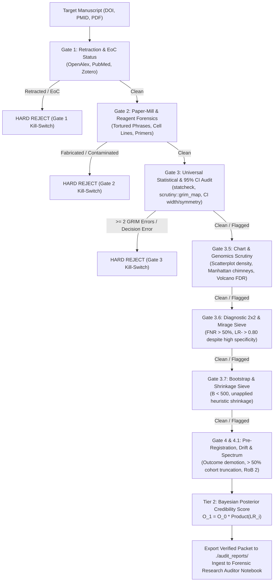

# Autonomous Forensic Research Auditing Pipeline (Universal Table, 95% CI & Diagnostic Matrix Edition)

[](https://opensource.org/licenses/MIT)

An autonomous metascience and forensic peer-review framework for Google Antigravity, powered by `gemini-3.8-flash` under adversarial `/boost` verification.

> [!TIP] Live Interactive GitHub Page & Bayesian Calculator
> The live interactive web portal and Bayesian Credibility Calculator are available at:  
> **[https://lauyeehow1986-hub.github.io/forensic_research_auditor/](https://lauyeehow1986-hub.github.io/forensic_research_auditor/)**

This repository provides an automated, non-compensatory forensic auditing suite designed to evaluate scientific manuscripts, preprints, randomized clinical trials, diagnostic prediction models, and observational studies across all text sections, numerical tables (Table 1 through Table $N$), 95% confidence intervals, diagnostic matrices, bootstrap resampling flows, and data visualizations (scatterplots, forest plots, Manhattan/volcano plots).

---

## 1. Repository Architecture

```text
forensic_research_auditor/
├── .agents/
│   └── mcp_config.json          # Model Context Protocol (MCP) server definitions
├── skills/
│   └── forensic-auditor/        # Dedicated Google Antigravity Skill
│       ├── SKILL.md             # Core skill specification & 4-Gate execution instructions
│       ├── scripts/
│       │   └── audit_paper.R    # Standalone R forensic statistical & diagnostic audit script
│       └── references/
│           ├── antigravity_kit.md        # Antigravity AGENTS.md & mcp_config.json deployment kit
│           ├── audit_paper_r.md          # Complete R audit script reference (Base R fallback enabled)
│           └── example_42802996_audit.md # Full worked reference verification packet (SCRATCH-HTN)
├── docs/
│   ├── GEMINI_NOTEBOOK_GUIDE.md # Comprehensive guide for Gemini Notebook integration & synthesis
│   ├── FACT_VERIFICATION_APIS_AND_MCP.md # Complete reference of MCP servers and REST APIs for fact verification
│   └── index.html               # Interactive web portal & live Tier 2 Bayesian Credibility Calculator
├── scripts/
│   └── audit_paper.R            # Universal R forensic suite (statcheck, GRIM, Benford, CI, Diagnostic 2x2, Bootstrap, Spectrum)
├── audit_reports/               # Generated verification packets (Markdown format)
│   └── README.md                # Report storage guidelines & ingestion instructions
├── AGENTS.md                    # Universal Table & Chart Orchestrator rules & kill-switches
├── .gitignore                   # Excludes raw data, scrapes, and target case study runs
└── README.md                    # System documentation and replication guide
```

---

## 2. Theoretical Framework & Non-Compensatory Triage

The auditing engine enforces a **lexicographic non-compensatory triage rule**: methodological or statistical fatal flaws cannot be compensated for by high citation counts, prestigious journal placement, or positive narrative framing.



### The Enhanced Forensic Gates:
1. **Gate 1 (Retraction & Metadata Forensics):** Cross-verifies retraction databases, Expressions of Concern (EoC), and PubPeer flags. *(Immediate Hard Kill-Switch if retracted)*.
2. **Gate 2 (Paper-Mill & Reagent Screening):** Natural-language scanning for Problematic Paper Screener tortured phrases, unvalidated nucleotide sequences, and contaminated cell lines (ICLAC register).
3. **Gate 3 (Universal Statistical & 95% CI Audit across ALL Tables):**
   - Extracts inline NHST statistics and validates degrees of freedom, test values, and $p$-values via `statcheck`.
   - Executes `scrutiny::grim_map()` across **every** summary table (Table 1 baselines, primary/secondary outcomes, subgroup tables) to detect mathematically impossible integer means.
   - Evaluates 95% confidence intervals for linear/log symmetry, variance compression (too-narrow CI, $LR = 0.15$), and GRADE imprecision (too-wide CI crossing MCID, $LR = 0.40$).
   - Computes Benford's Law first-digit distribution conformity on multi-magnitude values (with guardrails refusing homeostatically bounded vitals).
   - Carlisle Table 1 baseline uniformity audit (with guardrails strictly restricted to RCTs).
4. **Gate 3.5 (Universal Chart & Multi-Omics Genomics Audit):**
   - Evaluates data density in scatterplots, regression lines, and forest plots ($LR = 0.20$ if claimed extreme zone has $< 10\%$ support).
   - Audits Manhattan plots for single-SNP isolated chimneys ($LR = 0.15$) and Q-Q inflation anomalies.
   - Audits volcano plots for raw-$p$ masquerading as FDR and noise-zone hub gene cherry-picking ($LR = 0.20$).
5. **Gate 3.6 (Diagnostic 2x2 Matrix & High Specificity Mirage):**
   - Reconstructs full 2x2 contingency matrix (TP, FP, FN, TN).
   - Flags the **High Specificity Mirage**: touting $\ge 90\%$ specificity while concealing $FNR > 50\%$ or $LR- > 0.80$ ($LR = 0.20$).
6. **Gate 3.7 (Bootstrap Resampling & Shrinkage Sieve):**
   - Audits iteration sufficiency ($B < 500$ flagged as unstable).
   - Exposes sample size vs. iteration conflation (e.g. $B = 0.5 \times N$).
   - Flags unapplied heuristic or bootstrap shrinkage where deployed formulas/calculators use raw unpenalized betas ($LR = 0.60$).
8. **Gate 3.8 (Cochran Sparse Table & Expected Count Sieve):**
   - Reconstructs $2 \times 2$ expected cell counts $E_{ij} = (R_i C_j) / N$.
   - Flags Cochran's rule violation when any cell $< 1$ or $> 20\%$ of cells $< 5$.
   - Detects inappropriate uncorrected Pearson $\chi^2$ testing on sparse cells where Fisher's exact test was required ($LR = 0.20$).
9. **Gate 3.9 (Logit Linearity & Continuous Ratio Skewness Sieve):**
   - Audits continuous hemodynamic and biomarker ratios ($E/e'$, ACR, NT-proBNP).
   - Flags logit linearity violations and outlier leverage when modeled as untransformed linear terms without evaluating splines or log-transforms ($LR = 0.35$).
10. **Gate 4.2 (Population-Phenotype Cutoff & Construct Validity Sieve):**
    - Audits clinical thresholds against target population guidelines.
    - Flags paradoxical Western cutoff imports (e.g. Western $\text{BMI} > 30 \text{ kg/m}^2$ applied to Asian cohorts instead of WHO Asian $\ge 27.5 \text{ kg/m}^2$; $LR = 0.25$).
11. **Gate 4.3 (Methods-to-Table Descriptive & Non-Parametric Discrepancy Sieve):**
    - Flags boilerplate copy-paste contradictions (e.g. methods claiming "mean ± SD and Student's t-test" while tables report exclusively Medians and IQRs, with risk of invalid parametric testing on skewed distributions; $LR = 0.40$).
12. **Gate 4 & Gate 4.1 (Pre-Registration, Spectrum Truncation & Methodological Bias):**
    - Exposes Abstract-to-Text reporting drift and primary outcome demotion spin ($LR = 0.40$).
    - Audits cohort flow for severe spectrum truncation ($> 50\%$ excluded) and etiological purging ($LR = 0.35$).
    - Grades Cochrane RoB 2, PROBAST, or ROBINS-I domains supported with verbatim quotes.
    - Calculates the Bayesian Posterior Credibility Score $P(\text{Credible})$.

---

## 3. Environment Setup & Dependencies

### Prerequisites
- **Operating System:** Windows, macOS, or Linux.
- **R (>= 4.2.0):** Accessible via CLI (`Rscript`). Base R fallbacks are built-in for all functions.
- **Python (>= 3.10):** With `uv` and `uvx` package managers installed.
- **GitHub CLI (`gh`):** Authenticated for repository operations.

### R Forensic Suite Installation (Optional Enhancement)
The script runs in pure Base R out of the box. For enhanced speed and external parsing, install optional CRAN packages:
```bash
Rscript -e "install.packages(c('statcheck', 'scrutiny', 'rsprite2', 'benford.analysis', 'tibble'), repos='https://cloud.r-project.org')"
```

Verify that the universal audit script loads cleanly:
```bash
Rscript -e "source('scripts/audit_paper.R'); cat('R Forensic Suite verified successfully.\n')"
```

### MCP Servers & REST APIs for Ground-Truth Fact Verification
The pipeline enforces an adversarial zero-hallucination policy. Every claim, statistic, and protocol comparison is grounded in authoritative machine-readable APIs and MCP servers:

| Fact / Evidence Category | Primary MCP Server | Authoritative REST API | Ground Truth Verified |
| :--- | :--- | :--- | :--- |
| **Retraction & EoC Status** | `papers-openalex`, `pubmed`, `zotero` | OpenAlex API, CrossRef API, Europe PMC | Real-time `is_retracted` status, CrossMark update notices, Expressions of Concern, PubPeer flags. |
| **Paper-Mill & Reagent Forensics** | `pubmed`, `biomcp` | Problematic Paper Screener, ICLAC | Tortured phrase matching, contaminated cell line registries, primer validation. |
| **Statistical Computations** | `rstudio-mcp` | R 4.x runtime (`audit_paper.R`) | Verbatim `statcheck` NHST checks, `scrutiny::grim_map`, Benford distributions, 95% CI forensics. |
| **Diagnostic 2x2 & Resampling** | `rstudio-mcp` | R runtime (`audit_paper.R`) | 2x2 matrix reconstruction, High Specificity Mirage, bootstrap shrinkage, spectrum truncation. |
| **Genomics & Multi-Omics** | `open-targets-mcp` | GWAS Catalog REST API, Open Targets | Single-SNP chimneys, LD towers, FDR vs raw-p volcano plots, hub gene noise zones. |
| **Protocol Pre-Registration** | `pubmed` | ClinicalTrials.gov REST API v2 | Timestamped primary vs. secondary endpoints, protocol amendments, silent outcome demotion. |
| **Study Text & Quotes** | `pubmed`, `arxiv`, `zotero` | NCBI E-utilities (`efetch`), Europe PMC | Exact quotes for Cochrane RoB 2 domains and baseline table values. |

---

## 4. Google Antigravity Skill: `forensic-research-auditor`

This repository includes a fully packaged, self-contained Google Antigravity skill located at [`skills/forensic-auditor/`](skills/forensic-auditor/).

### Skill Architecture & Files
```text
skills/forensic-auditor/
├── SKILL.md                          # Core instructions, 4-Gate execution protocol & output structure
├── scripts/
│   └── audit_paper.R                 # Standalone R forensic suite (with Base R fallbacks)
└── references/
    ├── antigravity_kit.md            # AGENTS.md and .agents/mcp_config.json templates for Antigravity
    ├── audit_paper_r.md              # R audit script specification and documentation
    └── example_42802996_audit.md     # Reference audit packet demonstrating 4-Gate evaluation
```

### Invocation Commands
In any Antigravity conversation or prompt session, activate the skill with `/boost`:
```text
@forensic-research-auditor /boost
Run a comprehensive, universal Forensic Research Audit on [DOI, PMID, OR LOCAL PDF PATH] following ./AGENTS.md.
```

---

## 5. Replicating an Audit & Bayesian Scorecard

### Bayesian Scorecard Calculation

$$O_1 = O_0 \times \prod_{i} LR_i \quad \implies \quad P(\text{Credible}) = \frac{O_1}{1 + O_1}$$

- **Standard Prior Odds ($O_0$):**
  - Confirmatory Phase 3 Trial: $O_0 = 1.00$ ($P_0 = 50\%$).
  - Diagnostic / imaging strategies: $O_0 = 0.25$ ($P_0 = 20\%$).
  - Novel drug / device / therapeutic interventions: $O_0 = 0.10$ ($P_0 \approx 9.1\%$).
  - High-Risk / Low Biological Plausibility: $O_0 = 0.05$ ($P_0 \approx 4.8\%$).
- **Likelihood Ratio (LR) Penalties:**
  - Undeclared primary outcome switching: $LR = 0.05$
  - Benford's Law severe anomaly on numerical tables: $LR = 0.10$
  - Suspiciously narrow 95% CI (variance compression / SE-as-CI): $LR = 0.15$
  - Manhattan plot single-SNP chimney / GWAS mismatch: $LR = 0.15$
  - Cochrane RoB 2 "High Risk" (any domain): $LR = 0.15$
  - High Specificity Mirage (FNR > 50% or LR- > 0.80): $LR = 0.20$
  - Scatterplot over-extrapolation ($< 10\%$ tail data): $LR = 0.20$
  - Volcano plot raw-p masquerading as FDR / noise-zone hub gene: $LR = 0.20$
  - Single isolated non-decision rounding typo: $LR = 0.20$
  - Primary $p$-value in $.041 - .049$ $p$-hacking zone: $LR = 0.25$
  - Baseline Table 1 clinical imbalance confounding primary/interaction: $LR = 0.25$
  - Unreconciled sample size mismatch across tables: $LR = 0.30$
  - Severe Spectrum Truncation (> 50% excluded or primary etiology purged): $LR = 0.35$
  - Underpowered sample ($< 50\%$ power for target effect): $LR = 0.35$
  - Abstract-to-Text reporting drift / primary outcome demotion spin: $LR = 0.40$
  - Severe 95% CI imprecision (too-wide CI crossing MCID / failing GRADE OIS): $LR = 0.40$
  - Cochrane RoB 2 "Some Concerns" (2+ domains): $LR = 0.50$
  - Unapplied Shrinkage / Inadequate Resampling ($B < 500$): $LR = 0.60$
- **Likelihood Ratio (LR) Bonuses:**
  - Independent supporting replication in `scite.ai` or GWAS Catalog: $LR = 4.00$
  - Pre-registered with exact primary endpoint match: $LR = 2.50$
  - Open raw data and reproducible code verified: $LR = 2.00$

---

## 6. Mandatory Deliverables & Gemini Notebook Sync

Every audit produces 3 persistent files written to `./audit_reports/`:
1. `audit_[STUDY_KEY].md`: Structured 5-section consensus audit report.
2. `tweet_[STUDY_KEY].md`: Ready-to-copy Twitter/X disclosure thread.
3. `pubpeer_[STUDY_KEY].md`: Neutral, objective PubPeer-compliant comment.

Ingest the resulting markdown report directly into your **Forensic Research Auditor** Gemini Notebook:
- **Notebook URL:** [`https://gemini.google.com/notebook/6b8609aa-fa3d-4a82-a123-5ffe7b4518e1`](https://gemini.google.com/notebook/6b8609aa-fa3d-4a82-a123-5ffe7b4518e1)

---

## License

MIT License. Designed for academic research, metascience auditing, and computational peer review. Not for clinical decision-making.
