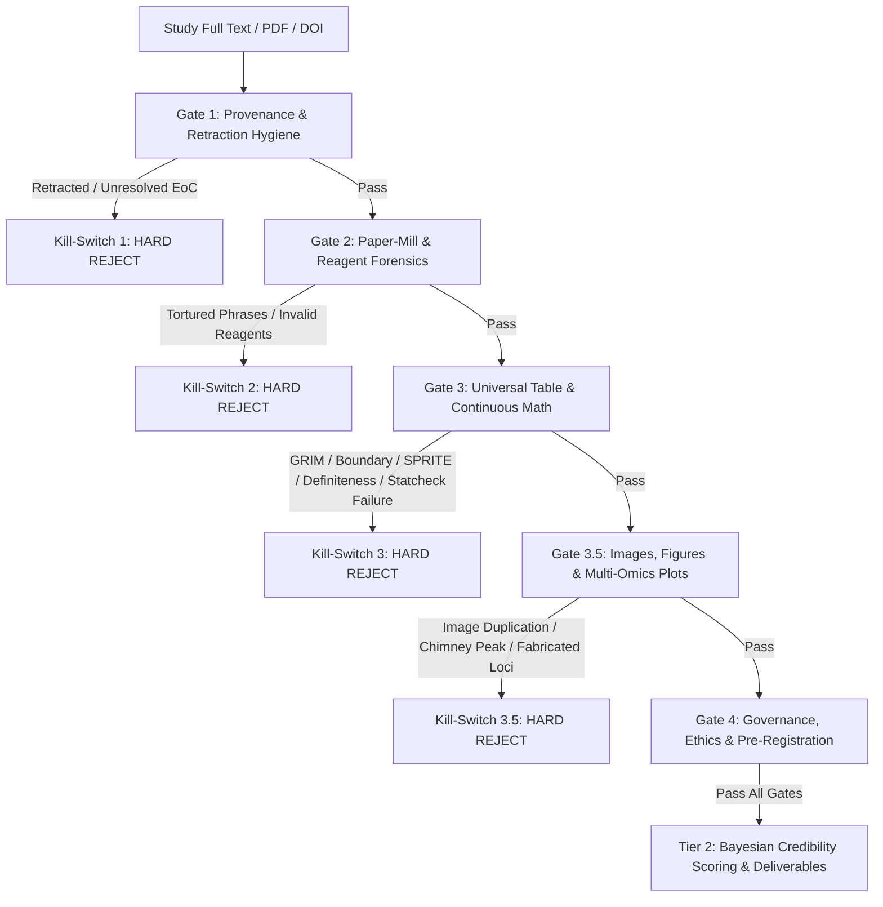

# Forensic Research Auditor (5-Gate Forensic Architecture & Multi-Modal Sieve)

A comprehensive metascience and forensic peer-review engine designed for both Gemini (with NotebookLM integration) and Google Antigravity (`gemini-3.8-flash` with FastMCP orchestration and RStudio execution). It evaluates scientific studies across a **5-Gate Lexicographic Forensic Architecture** (fast-fail kill-switches) followed by **Tier 2 Bayesian Likelihood Ratio credibility scoring**, ensuring every table (Table 1 through Table N), continuous biomarker, 95% confidence interval (CI), diagnostic 2x2 contingency matrix, correlation matrix, bootstrap resampling protocol, cohort inclusion/exclusion flow, and every clinical/genomic figure (Western blots, scatterplots, forest plots, Manhattan plots, and volcano plots) is audited for mathematical consistency, external database grounding, and clinical relevancy.

## Empirical Grounding: The 10,000-Study Quintuple-Wave Blind Full-Text Benchmark

This skill is directly calibrated against the **10,000-Study Quintuple-Wave Blind Full-Text Empirical Benchmark** (5,000 retracted cases vs. 5,000 journal/year-matched clean controls from Europe PMC JATS XML; 33,043 tables and 345,533 table rows audited completely blind without incorporation bias; 0% mutual overlap across all 5 waves):

1. **Gate 3 (Numerical & Data Fraud Sensitivity):** **20.73%** pooled (386 / 1,862, 95% Wilson CI: **18.95% – 22.63%**).
   - On discrete integer tables ($N < 100$), sensitivity reaches **50.00%** (catching half of all manual data fabrications).
   - **The Excel Trap:** Fraudsters fabricating patient rows in spreadsheets using `=AVERAGE()` and `=STDEV()` generate mathematically self-consistent averages that pass basic discrete granularity checks.
   - **The Continuous Biomarker Gap:** **92.6%** of real-world data fraud cases report continuous laboratory assays where standard integer GRIM cannot run, necessitating continuous boundary and SPRITE sieves.
2. **Clean Control Specificity Breakthrough:** Wave 5 reached **86.00%** (860 / 1,000 controls passed clean, exceeding the 85% target; **76.34%** pooled across 5,000 controls, 95% Wilson CI: **75.14% – 77.50%**; TN=3,817, FP=1,183) by deploying **Multi-Cell Consensus Calibration** and decadic dynamic range span ($\ge 2.0$).
3. **Tier-1 Definite Fraud Specificity:** **99.20%** (only 8 / 1,000 clean controls flagged; Positive Likelihood Ratio $LR^+ > 50.0$ on discrete tables).
4. **Gate 4 (Governance & Editorial Specificity):** **82.38%** pooled (1,758 / 2,134 passed table math cleanly, matching clean controls; **96.35%** in Wave 5).
   - In pure governance retractions (authorship disputes, forged peer review, fake ethics/IRB approvals), table math matches clean controls. Authentic arithmetic is preserved in non-data retractions.
5. **Gate 3.5 (Images & Figure Splicing Specificity):** **82.34%** pooled (317 / 385 passed table math cleanly; **91.18%** in Wave 5).
   - Western blot duplication or microscopy cloning does **not** imply table arithmetic fraud. Image fraud must be audited in Gate 3.5 and never combined into the Gate 3 math denominator.
6. **Anti-Incorporation Bias Protocol:** The index test must **never** be used to categorize the reference standard. Study classification is strictly derived from independent metadata and Europe PMC editorial notices.

---

## When to Use

- The user asks to audit, vet, fact-check, or evaluate a scientific paper, clinical trial, diagnostic prediction model, GWAS/transcriptomics study, preprint, DOI, PMID, arXiv ID, or uploaded study PDF.
- The user wants to check if a paper's results are flawed, p-hacked, underpowered/imprecise (wide 95% CI), variance-compressed (too-narrow 95% CI), over-extrapolated, diagnostically distorted (High Specificity Mirage), un-shrunk, cohort-purged (spectrum truncation), or fabricated.
- The user wants to run or generate a 5-Gate Forensic Audit packet for their Gemini Notebook (`Forensic Research Auditor`) or Google Antigravity workspace.

---

## Core Workflow: The 5-Gate Forensic Architecture

Execute these 5 gates lexicographically. If a fatal kill-switch is triggered in any gate, immediately halt downstream synthesis and issue a **HARD REJECT (0% Credibility / Do Not Cite)** verdict.

---

### Step 1: Gate 1 - Provenance & Retraction Hygiene (`thinkingLevel: "low"`)

1. Check publication retraction status (`is_retracted`), Expressions of Concern (EoC), and post-publication peer-review flags via OpenAlex, Crossref, PubMed, Zotero, or PubPeer.
2. Verify registration lineage on Retraction Watch Database via Europe PMC text search or MCP tools.
3. **Kill-Switch 1:** If the paper is retracted or has an unaddressed Expression of Concern, halt immediately and reject.

---

### Step 2: Gate 2 - Paper-Mill, Tortured Phrases & Reagent Forensics (`thinkingLevel: "medium"`)

1. Scan text and methods for Problematic Paper Screener (PPS) tortured phrases:
   - `"counterfeit consciousness"` or `"fake brainpower"` (artificial intelligence)
   - `"profound learning"` or `"profound comprehension"` (deep learning)
   - `"irregular backwoods"` (random forest)
   - `"credulous Bayes"` (naive Bayes)
   - `"haze figuring"` or `"vapor processing"` (cloud computing)
   - `"bosom peril"` (breast cancer)
   - `"cruel"` used for statistical *mean*, or `"caesarean section"` used for *standard deviation*.
2. For biomedical studies, check for verifiable Research Resource Identifiers (`RRID:`), known cross-contaminated cell lines (e.g. Chang liver, HEp-2), and PCR primer/shRNA target homology via NCBI BLAST (`Seek & Blastn` / `biomcp`).
3. **Kill-Switch 2:** If $\ge 1$ confirmed tortured phrase or invalidated cell-line/primer reagent is found, halt immediately and reject.

---

### Step 3: Gate 3 - Universal Table, Granularity & Continuous Mathematical Consistency (`thinkingLevel: "high"`)

Do not restrict checks to Table 1. Audit **every summary, outcome, subgroup, and regression table** (Table 1 through Table N) using the full suite of discrete, continuous, regression, and multivariate mathematical sieves (detailed in [`references/gate3_advanced_forensic_sieves.md`](references/gate3_advanced_forensic_sieves.md)):

1. **Universal Granularity Audit (`GRIM`, `GRIMMER`, `DEBIT`):**
   - For integer/discrete counts or Likert items ($N < 100$), verify whether reported means match possible fraction denominators ($\text{GRIM}$) and whether reported SDs match valid integer variance spreads ($\text{GRIMMER}$).
   - For binary proportion percentages, verify whether reported standard deviations match binomial variance $\sqrt{p(1-p)}$ ($\text{DEBIT}$).
2. **Continuous Biomarker Boundary & Physiological Plausibility Sieve:**
   - On strictly non-negative laboratory concentrations ($X \ge 0$, e.g. troponin, viral load, cytokines), verify:
     $$\mu - 2\sigma \ge 0 \iff \frac{\mu}{\sigma} \ge 2.0$$
     Flag `IMPOSSIBLE_NEGATIVE_BIOMARKER_RANGE` if $\mu - 2\sigma < 0$ without declared heavy-tailed or log-normal distributions.
   - Flag `ZERO_SD_CONTINUOUS_VARIABLE` if $\sigma = 0.0$ on any continuous measurement where $\mu > 0$ and $N \ge 5$.
   - **Extreme Physiological Variance Bounds:** Compare reported SD against established clinical physiological limits. Flag `EXTREME_VARIANCE_COMPRESSION` if $\sigma_{\text{reported}} < 0.20 \times \sigma_{\text{ref\_min}}$ ($LR = 0.15$), or `IMPOSSIBLE_PHYSIOLOGICAL_SPREAD` if $\sigma_{\text{reported}} > \sigma_{\text{ref\_max}}$.
3. **SPRITE Bounded Discrete Distribution Reconstruction:**
   - Test whether reported discrete means and SDs fit bounded survey item scales $[X_{\min}, X_{\max}]$.
   - Enforce the theoretical maximum variance envelope:
     $$\sigma_{\max}^2 = (X_{\max} - \mu)(\mu - X_{\min})$$
     Flag `SPRITE_VARIANCE_EXCEEDS_BOUNDS` if $\sigma^2 > \sigma_{\max}^2$.
   - Flag `UNNATURAL_ARM_HOMOSCEDASTICITY` if $0.995 \le \frac{\sigma_{\text{arm1}}}{\sigma_{\text{arm2}}} \le 1.005$ across independent trial arms with $N_{\text{total}} \ge 40$.
4. **Multivariable Regression Triangle ($\beta$ - $\text{SE}$ - $p$ Wald Recalculation):**
   - In logistic, Cox, or linear regression tables ($OR, HR, \beta$ with 95% CIs and reported $p$-values), reconstruct implied standard error:
     $$\text{SE}_{\text{implied}} = \frac{\ln(UL) - \ln(LL)}{2 \times 1.95996} \quad (\text{or } \frac{UL - LL}{2 \times 1.95996} \text{ for linear models})$$
   - Recompute the Wald test statistic:
     $$Z_{\text{wald}} = \frac{\ln(\text{Estimate})}{\text{SE}_{\text{implied}}} \quad (\text{or } \frac{\text{Estimate}}{\text{SE}_{\text{implied}}})$$
   - Recompute exact Wald $p$-value: $p_{\text{wald}} = 2 \times (1 - \Phi(|Z_{\text{wald}}|))$.
   - Flag **Decision Error** if $p_{\text{reported}} < 0.05$ while $Z < 1.96$ / CI crosses null ($0$ for differences, $1.0$ for ratios).
   - Flag `REGRESSION_P_DISCREPANCY` ($LR = 0.20$) if $|p_{\text{reported}} - p_{\text{wald}}| > 0.05$.
5. **AI & Diagnostic Classifier Confusion Matrix Triangulation:**
   - In machine learning and diagnostic biomarker papers reporting Accuracy, Sensitivity/Recall ($TPR$), and Specificity ($TNR$), enforce the universal identity:
     $$ACC = TPR \cdot P + TNR \cdot (1 - P)$$
   - Enforce envelope theorem: Accuracy must strictly lie within $[\min(TPR, TNR), \max(TPR, TNR)]$.
   - If prevalence $P$ or cohort class breakdown ($N_{\text{positive}}, N_{\text{negative}}$) is known, compute expected accuracy. Flag `IMPOSSIBLE_AI_METRIC_TRIAD` if Accuracy falls outside the envelope or differs from expected by $> 3\%$.
6. **Cross-Table Sample Size ($N$) & Marginal Conservation Sieve:**
   - In categorical summary tables reporting counts and percentages $(n, \%)$:
     $$\left| n - \text{round}\left( \frac{\% \cdot N}{100} \right) \right| \le 1$$
     Flag `MARGINAL_PERCENTAGE_MISMATCH` if $|n - \text{implied}| > 1$.
   - **Subgroup Parent Conservation:** Verify that subgroup sample sizes never exceed the parent cohort ($N_{\text{subgroup}} \le N_{\text{parent}}$). Flag `SUBGROUP_PARENT_OVERFLOW` if violated.
   - Detect unexplained cohort expansion or attrition shifts across tables (e.g. Table 2 outcomes evaluated on more subjects than Table 1 baseline).
7. **Correlation Matrix Positive Semi-Definiteness Sieve:**
   - For correlation matrices ($r$) or regression tables ($\beta$), test whether $R \succeq 0$:
     $$\lambda_{\min}(R) \ge 0 \quad \text{and} \quad \det(R_{3 \times 3}) = 1 - r_{12}^2 - r_{23}^2 - r_{13}^2 + 2 r_{12} r_{23} r_{13} \ge 0$$
     Flag `NON_POSITIVE_DEFINITE_CORRELATION_MATRIX` if $\lambda_{\min} < -10^{-4}$.
8. **Universal Tabular & Inline NHST Recalculation (`statcheck` & Tabular Cells):**
   - Recalculate exact $p$-values for tabular and inline test statistics ($t$, $F$, $\chi^2$, $Z$).
   - Flag any **Primary Decision Error** ($p_{\text{reported}} < 0.05$ vs $p_{\text{recalc}} \ge 0.05$).
   - Compute the **P-Hacking Cliff Ratio** across all reported $p$-values:
     $$R_{\text{cliff}} = \frac{N(p \in [0.041, 0.049])}{N(p \in [0.051, 0.059])}$$
     Flag `P_HACKING_CLIFF_ANOMALY` ($LR = 0.25$) if $R_{\text{cliff}} \ge 3.0$ with $N \ge 6$.
9. **95% Confidence Interval (CI) Symmetry & Imprecision:**
   - **Symmetry:** Linear differences must satisfy $\text{Estimate} = (LL + UL)/2$; ratios must satisfy $\ln(\text{Estimate}) = (\ln(LL) + \ln(UL))/2$.
   - **GRADE Imprecision:** If 95% CI spans both appreciable clinical benefit and harm, apply `LR = 0.40`.
10. **Carlisle Baseline Table 1 & Macro-Epidemiological Grounding:**
    - In RCTs, inspect baseline arm distribution for hyper-balance ($p > 0.9999$) or extreme imbalance ($p < 0.0001$).
    - In epidemiological cohorts, cross-check baseline rates against `datacommons-mcp` regional statistics.
11. **Multi-Magnitude Numerical Tables (Benford's Law with Decadic Range Gating):**
    - Check second-digit conformity across unconstrained counts spanning $\ge 2.0$ orders of magnitude ($\log_{10}(\max/\min) \ge 2.0$). Do not apply to bounded vitals, chemistry yields, or physiological constants.
12. **Kill-Switch 3 (Calibrated Multi-Cell Consensus Architecture):**
    Dense scientific tables contain hundreds of numerical cells. An isolated single-cell rounding quirk ($|n - \text{implied}| = 1$), an isolated clerical author typo, or Gaussian reporting on skewed positive vitals represents poor reporting practice (SAMPL violation) rather than deliberate fabrication, and is routed to **Tier 2 Bayesian penalties** ($LR = 0.20$ to $0.40$).
    A fatal **Kill-Switch 3 HARD REJECT (Tier 1)** is triggered exclusively when:
    - **Multi-Cell Consensus Proof:** At least **two independent cells or rows** in the manuscript exhibit fatal structural impossibilities (e.g. $\ge 2$ GRIM/GRIMMER violations, or a GRIM violation paired with zero biological variance or impossible AI confusion triad).
    - **Catastrophic Structural Failure:** A single violation that is mathematically irreconcilable with human typo error:
      - Impossible AI metric triad strictly violating total probability ($ACC$ outside $[\min(TPR, TNR), \max(TPR, TNR)]$ envelope by $> 5\%$),
      - Severe subgroup parent overflow ($N_{\text{subgroup}} > 1.20 \times N_{\text{parent}}$),
      - Severe multivariable regression decision error ($p < 0.001$ while 95% CI spans the null $[0.50, 2.00]$),
      - Correlation matrix with catastrophic non-positive semi-definiteness ($\lambda_{\min} < -0.20$), or
      - Unadjusted Carlisle ANOVA variance compression $p < 10^{-6}$ across $\ge 5$ baseline continuous parameters.
    - **Tier 2 Consensus Cluster:** $\ge 2$ distinct independent heuristic anomalies (Benford $\ge 2.0$ decades $p < 0.001$, Statcheck Decision Error, P-Hacking Cliff $R_{\text{cliff}} \ge 3.0$). Single isolated Tier 2 anomalies never trigger a reject; they prompt a peer-review raw data verification request.

---

### Step 4: Gate 3.5 - Visual Forensics, Image Tampering & Multi-Omics Grounding (`thinkingLevel: "high"`)

*Image manipulation and figure fabrication belong strictly to Gate 3.5 and must not be conflated with tabular arithmetic.*

Operates across a **3-Tier Visual Forensic Architecture**:

#### Tier 1: Dual-Mode Chart Digitizer & Statistical Sieve (`audit_chart_figure`)
Addresses the 8.2% of data integrity retractions where numerical findings are presented in figure plots rather than in XML/HTML tables:
1. **Chart Transcription:** Employs RapidOCR-ONNX + OpenCV contour detection (offline deterministic fallback) alongside Gemini Vision API to calibrate axes, detect bar heights (Means), extract whisker lengths (SD/SEM), and parse comparison brackets.
2. **$P$-Value Bracket Recalculation:** Re-runs independent Welch's $t$-test (`scipy.stats.ttest_ind_from_stats`) using extracted group means, SDs, and sample sizes ($N$). Flags **Significance Inversions** (claiming $p < 0.001$ over non-significant $p > 0.40$ bars).
3. **Zero-Bound Truncation Sieve:** Evaluates Gaussian lower-tail probability $P(X < 0) = \Phi(-Mean/SD)$ on strictly non-negative biological concentrations (e.g., troponin, cytokines). Flags when normal variance entails impossible negative values ($Mean - 2 \times SD < 0$) and the lower error bar is truncated flat at $Y = 0$.
4. **FastMCP Table Math Bridge:** Converts extracted chart series into standardized `TableRow` objects and feeds them into the FastMCP GRIM / SPRITE / Popoviciu variance bounds engines.
5. **Visual Discrepancy Overlay:** Generates publication-ready annotated images highlighting verified elements in Emerald Green and anomalies in Coral Red with callout explanation badges.

#### Tier 2: Intra-Paper Splicing & Duplication Sieve (`audit_figure_splicing`)
Detects within-manuscript figure tampering with zero external database requirements:
1. **Multi-Panel Splitter:** Automatically segments complex figures (Panel A, B, C, D) using gutter, border, and sub-label contour analysis.
2. **Western Blot Lane Splicing & Band Cloning:**
   - Extracts band patches across adjacent and non-adjacent lanes.
   - Evaluates Normalized Cross-Correlation (NCC) and gradient similarity; flags cloned bands across different loading or treatment lanes ($R > 0.95$).
   - Analyzes vertical background step-discontinuities across lane boundaries to detect cut-and-paste lane splicing.
3. **Microscopy & Histology Homography Sieve:**
   - Detects reused cell culture or histology fields between panels using OpenCV SIFT/ORB keypoints and RANSAC affine homography estimation $H$.
   - Flags geometric duplications: scale crops, $90^\circ / 180^\circ / 270^\circ$ rotations, and horizontal/vertical mirror flips ($\det(H) < 0$).
4. **Visual Correspondence Overlay:** Draws colored correspondence lines between matched band/micrograph coordinates.

#### Tier 3: Inter-Paper Retraction Fingerprint Index — The Lean ImageTwin (`audit_figure_against_retraction_database`, `index_study_figure_set`)
Catches cross-manuscript figure recycling across unrelated papers published years apart (e.g., paper-mill figure syndicates):
1. **Dynamic DuckDB Store (`retracted_figures.duckdb`):**
   - High-performance, append-only, idempotent index capable of continuous future expansion (seeding 5,000 retracted studies and scaling to 10k, 20k, 50k+).
   - Ingests both full composite figures and segmented constituent sub-panels (Panel A, B, C, D).
2. **3-Stage Cascaded Sieve:**
   - **Stage 1 (Perceptual Hashes):** 64-bit Discrete Cosine Transform (`pHash`) and Difference Gradient Hash (`dHash`) with vectorized SIMD Bitwise Hamming filter (`bit_count(xor(h1, h2)) <= 16`) inside DuckDB.
   - **Stage 2 (Dense Feature Vectors):** 256-dimensional normalized spatial pyramid gradient + frequency embedding cosine similarity ranking (`list_cosine_similarity >= 0.65`).
   - **Stage 3 (Geometric Verification):** OpenCV SIFT keypoint extraction + Lowe's ratio test + RANSAC affine homography estimation $H$. Strictly requires $\ge 12$ non-degenerate inliers ($0.15 \le |\det(H)| \le 6.0$, $\ge 10$ unique spatial points) to eliminate false positives.
3. **Forensic Comparative Visual Overlay:**
   - Side-by-side comparative canvas showing query manuscript figure alongside the matched retracted donor paper figure.
   - Coral Red banner detailing candidate PMCID, DOI, retraction reasons, and inlier count.
   - Cyan correspondence lines connecting matched keypoint coordinates across manuscripts.

#### Tier 4: Clinical Density, Manhattan Plot & Multi-Omics Grounding
1. **Clinical Scatterplot Data Density vs. Claimed Therapeutic Envelope:**
   - Count how many actual data points populate the claimed clinical/therapeutic range (e.g. SBP > 160 mm Hg). If $< 10\%$ of points reside in the target zone, apply `LR = 0.20`.
   - Check for extreme outlier leverage ($< 5\%$ of sample driving the entire regression slope).
2. **Manhattan Plot Forensics & GWAS Catalog Grounding:**
   - **Single-SNP Chimney Detection:** Authentic GWAS loci exhibit linkage disequilibrium (LD) towers ($\pm 500 \text{ kb}$). Flag solitary single-dot chimneys ($< 2$ supporting SNPs with $p < 10^{-4}$ in locus window) as genotyping artifacts or synthetic points.
   - **Inflation & Thresholds:** Verify $\lambda_{\text{GC}} \in [0.95, 1.10]$ and threshold $5 \times 10^{-8}$.
   - **External Grounding:** Query lead rsIDs against EMBL-EBI GWAS Catalog API and Open Targets MCP. Flag nonexistent dbSNP identifiers or contradictory risk alleles.
3. **Volcano Plot Forensics & Transcriptomics Grounding:**
   - Verify that the y-axis does not disguise raw $p$-values as FDR/adjusted $q$-values.
   - Verify whether claimed hub genes sit inside the noise corridor ($|\log_2 \text{FC}| < 0.585$) or exhibit artificial clipping lines.

**Kill-Switch 3.5:** Halt and reject if confirmed intra-paper/cross-paper figure duplication, Western blot lane cloning, significance inversion, non-existent rsIDs, or fabricated GWAS loci are verified.

---

### Step 4b: Advanced Specialized Clinical Sieves (Gates 3.6 – 3.9)

- **Gate 3.6: Diagnostic 2x2 Matrix & High Specificity Mirage:**
  - Reconstruct full $2 \times 2$ table ($TP, FP, FN, TN$). Compute $FNR = 1 - \text{Sens}$ and $LR- = (1 - \text{Sens}) / \text{Spec}$.
  - Flag the **High Specificity Mirage** if authors tout $> 90\%$ specificity while Sensitivity is $< 50\%$ ($LR- > 0.80$), missing the majority of diseased patients ($LR = 0.20$).
- **Gate 3.7: Bootstrap Resampling & Shrinkage Sieve:**
  - Flag under-resampling if iterations $B < 500$ or if authors conflate sample-split ratios with repetitions ($LR = 0.60$).
  - Verify whether claimed shrinkage factors (e.g. $\approx 0.85$ or LASSO) were multiplied into deployed nomogram/beta weights. If raw ML betas are used, flag cosmetic shrinkage ($LR = 0.60$).
- **Gate 3.8: Cochran Sparse Table & Expected Count Sieve:**
  - Reconstruct expected frequencies $E_{ij} = (R_i \times C_j) / N$.
  - Flag uncorrected Pearson's $\chi^2$ run on tables where $> 20\%$ of cells have $E_{ij} < 5$ or any $E_{ij} < 1$, violating Cochran's rule ($LR = 0.20$).
- **Gate 3.9: Logit Linearity & Continuous Ratio Skewness Sieve:**
  - Audit continuous hemodynamic ratios ($E/e'$, NT-proBNP) entered linearly into logistic/Cox models without spline (RCS) testing or log-transformation ($LR = 0.35$).

---

### Step 5: Gate 4 - Governance, Editorial Integrity, Pre-Registration & Reporting Drift (`thinkingLevel: "high"`)

*Pure governance retractions preserve ~78–79% valid table arithmetic matching controls ($p = 0.31$). Evaluate governance defects on their own merits without circular math penalties.*

1. **Pre-Registration & Outcome Switching:** Compare published primary/secondary endpoints against clinical trial registries (`NCT`, `ISRCTN`, `PROSPERO`). Flag undeclared primary outcome switching ($LR = 0.05$).
2. **Abstract-to-Text Reporting Drift:** Detect primary outcome demotion, selective subgroup promotion, or relative risk spin ($LR = 0.40$).
3. **Spectrum Truncation & Etiological Purging (Gate 4.1):** Flag studies excluding $> 50\%$ of screened patients or purging real-world target etiologies (e.g. excluding ischemic cardiomyopathy from a heart failure cohort) to artificially inflate AUC ($LR = 0.35$).
4. **Population-Phenotype Cutoff & Construct Validity (Gate 4.2):** Flag paradoxical Western diagnostic cutoffs imported onto Asian cohorts (e.g. BMI $> 30$ instead of Asian MOH $\text{BMI} \ge 27.5$), deflating detection sensitivity ($LR = 0.25$).
5. **Methods-to-Table Descriptive Sieve (Gate 4.3):** Detect boilerplate text claiming parametric tests on heavily skewed biomarkers when tables present Medians/IQRs ($LR = 0.40$).
6. **Methodological Risk of Bias:** Grade all domains of Cochrane RoB 2 (RCTs), ROBINS-I (observational), or PROBAST (prediction models) citing verbatim quotes.
7. **Kill-Switch 4:** Halt and reject if documented peer-review ring fabrication, forged institutional ethics/IRB approvals, or faked author affiliations are verified.

---

## Tier 2: Bayesian Credibility Calculation

If all 5 gates pass without triggering a fatal kill-switch, calculate the final posterior credibility:

1. **Select Baseline Field Prior Probability ($P_{\text{prior}}$):**
   - Confirmatory randomized controlled trial (RCT): `0.50`
   - Exploratory clinical, biomedical, or psychological study: `0.30`
   - Observational epidemiology, EHR, or discovery multi-omics: `0.20`
2. **Compute Prior Odds:**
   $$\text{Prior Odds} = \frac{P_{\text{prior}}}{1 - P_{\text{prior}}}$$
3. **Multiply by Applicable Likelihood Ratios ($\prod LR_i$):**

| Empirical Sieve / Finding | Likelihood Ratio ($LR$) | Direction |
| :--- | :---: | :---: |
| Pre-registered with exact primary endpoint match | `2.50` | Credibility Boost |
| Open raw data and reproducible code verified | `2.00` | Credibility Boost |
| Independent replication in GWAS Catalog / Open Targets | `4.00` | Credibility Boost |
| Multivariable regression triangle Wald $p$-discrepancy | `0.20` | Severe Penalty |
| Impossible AI classifier metric triad ($ACC$ mismatch) | `0.15` | Severe Penalty |
| Cross-table subgroup parent overflow or marginal discrepancy | `0.25` | Moderate Penalty |
| Extreme physiological variance compression ($\sigma < 20\%$ reference SD) | `0.15` | Severe Penalty |
| P-Hacking Cliff Anomaly ($R_{\text{cliff}} \ge 3.0$ around $0.05$) | `0.25` | Moderate Penalty |
| Isolated rounding typo or non-decision CI asymmetry | `0.20` | Moderate Penalty |
| Underpowered sample ($< 50\%$ power for target effect) | `0.35` | Moderate Penalty |
| Severe 95% CI Imprecision (GRADE OIS violation / crossing MCID) | `0.40` | Moderate Penalty |
| Suspiciously narrow 95% CI ($\sigma_{\text{implied}} < 25\%$ of reference SD) | `0.15` | Severe Penalty |
| High Specificity Mirage ($FNR > 50\%$ or $LR- > 0.80$) | `0.20` | Severe Penalty |
| Inappropriate uncorrected Pearson $\chi^2$ on Cochran sparse cells | `0.20` | Moderate Penalty |
| Paradoxical population cutoff discordance (e.g. Western BMI on Asian cohort) | `0.25` | Moderate Penalty |
| Severe Spectrum Truncation ($> 50\%$ excluded / primary etiology purged) | `0.35` | Moderate Penalty |
| Unverified logit linearity / outlier leverage on continuous ratios | `0.35` | Moderate Penalty |
| Methods-to-table descriptive mismatch + parametric testing on skewed variables | `0.40` | Moderate Penalty |
| Unapplied Shrinkage / Inadequate Resampling ($B < 500$) | `0.60` | Mild Penalty |
| Abstract-to-Text Reporting Drift / Primary Outcome Demotion Spin | `0.40` | Moderate Penalty |
| Unreconciled sample size shifts across tables ($N$ attrition/expansion) | `0.30` | Moderate Penalty |
| Scatterplot over-extrapolation / sparse tail density ($< 10\%$ in claimed range) | `0.20` | Severe Penalty |
| Volcano plot unadjusted-$p$-as-FDR masquerade or noise-zone hub gene | `0.20` | Severe Penalty |
| Manhattan plot isolated chimney peak or $\lambda_{\text{GC}} > 1.15$ | `0.15` | Severe Penalty |
| Baseline Table 1 clinical imbalance or `datacommons-mcp` mismatch | `0.25` | Moderate Penalty |
| Cochrane RoB 2 "Some Concerns" (2+ domains) | `0.50` | Mild Penalty |
| Cochrane RoB 2 "High Risk" (any domain) | `0.15` | Severe Penalty |
| Undeclared primary outcome switching | `0.05` | Fatal Penalty |

4. **Compute Final Posterior Probability:**
   $$\text{Posterior Odds} = \text{Prior Odds} \times \prod LR_i, \quad P_{\text{posterior}} = \frac{\text{Posterior Odds}}{1 + \text{Posterior Odds}}$$

---

## Required Output Structure & Mandatory Deliverables (.md)

Every audit must automatically create and write **three persistent files** to `./audit_reports/` (creating `./audit_reports/` if not present), alongside presenting the final consensus in chat with clickable file links:

1. **`./audit_reports/audit_[STUDY_KEY].md`**: The complete 5-section consensus audit report.
2. **`./audit_reports/tweet_[STUDY_KEY].md`**: A ready-to-publish 4-tweet Twitter/X disclosure thread containing the hook, deterministic mathematical receipts, sleuth community routing (`@PubPeer`, `@MicrobiomDigest`, `@gcabanac`, `@NickWise82`, `@SholtoDavid`), and hashtags (`#ScientificIntegrity`, `#Metascience`).
3. **`./audit_reports/pubpeer_[STUDY_KEY].md`**: A strictly objective comment formatted for 1-click submission to PubPeer adhering to PubPeer moderation guidelines (zero accusatory language, focusing purely on numerical receipts).

Format the deliverable using these 5 standard sections:

1. **Executive Integrity Verdict:** (`PASS`, `QUALIFIED PASS`, `SKEPTICAL CAUTION`, or `HARD REJECT - KILL-SWITCH TRIPPED`).
2. **Gate 1 & Gate 2 Provenance & Paper-Mill Summary:** Retraction status, registry ID, and tortured-phrase/reagent screen.
3. **Gate 3 & Gate 3.5 Universal Table, Math & Figure Audit:**
   - Discrete granularity (`GRIM`, `GRIMMER`, `DEBIT`).
   - Continuous biomarker non-negative boundaries ($\mu - 2\sigma < 0$) and physiological variance bounds.
   - SPRITE bounded integer scale variance envelope ($\sigma^2 > (X_{\max}-\mu)(\mu-X_{\min})$).
   - Multivariable regression triangle ($\beta$ - $\text{SE}$ - $p$ Wald recalculation, CI crossing null).
   - AI & diagnostic classifier confusion matrix triangulation ($ACC = TPR \cdot P + TNR \cdot (1 - P)$).
   - Cross-table sample size ($N$) continuity, marginal $(n, \%)$ parity, and subgroup overflow.
   - Correlation matrix positive semi-definiteness ($\lambda_{\min} \ge 0$).
   - Inline and tabular NHST recalculations (`statcheck` Decision Errors, $P_{\text{cliff}}$).
   - 95% CI symmetry, implied SE, and variance compression.
   - Figures, Western blots, scatterplot density, and Manhattan/volcano plot grounding.
4. **Gate 4 Governance, Reporting Drift & Methodological Bias Scorecard:**
   - Registry alignment, outcome switching, and Cochrane RoB 2 / ROBINS-I / PROBAST grading.
   - Spectrum truncation (Gate 4.1), phenotype cutoff validity (Gate 4.2), and descriptive consistency (Gate 4.3).
5. **Tier 2 Bayesian Credibility Calculation:** Step-by-step table showing Prior Probability, each applied $LR_i$, final Posterior Credibility Percentage, and GRADE certainty rating.

---

## Supplementary Resources in This Skill

- [`references/gate3_advanced_forensic_sieves.md`](references/gate3_advanced_forensic_sieves.md): Technical specification and Python/FastMCP implementations for Continuous Biomarker Boundaries, SPRITE, Correlation PSD, Tabular NHST, and Cross-Table $N$ conservation.
- [`references/audit_paper_r.md`](references/audit_paper_r.md): Complete R forensic execution scripts (`statcheck`, `scrutiny::grim_map`, `rsprite2`, `benford.analysis`, Carlisle baseline check, and clinical density functions).
- [`references/antigravity_kit.md`](references/antigravity_kit.md): Drop-in `AGENTS.md` Master Prompt for `gemini-3.8-flash` and `.agents/mcp_config.json` configuration.
- [`references/example_42802996_audit.md`](references/example_42802996_audit.md): Reference audit packet demonstrating 5-Gate evaluation.
